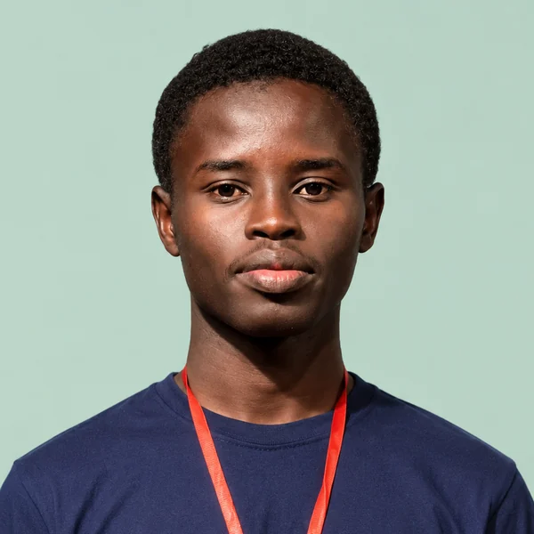

```{=html}
<div class="home-layout">
  <div class="home-side-slot" aria-hidden="true"></div>  <!-- réserve la colonne gauche quand le profil est fixé -->
  <div class="home-side">
    
    <h1 class="hp-name" id="home-name">Abdel-aziz Harane Abounounou</h1>
    <p class="hp-role">Ingénieur ML/NLP; fondateur de <a href="https://chadainetwork.org" target="_blank" rel="noopener">Chad AI Network</a></p>
    <div class="links hp-links">
      <a class="lk hp-link" href="https://github.com/abdelazizharane" target="_blank" rel="noopener"><svg viewBox="0 0 24 24" fill="currentColor"><path d="M12 2C6.477 2 2 6.477 2 12c0 4.418 2.865 8.166 6.839 9.489.5.092.682-.217.682-.482 0-.237-.009-.868-.013-1.703-2.782.605-3.369-1.342-3.369-1.342-.454-1.155-1.11-1.462-1.11-1.462-.908-.62.069-.608.069-.608 1.003.07 1.531 1.03 1.531 1.03.892 1.529 2.341 1.087 2.91.832.092-.647.35-1.088.636-1.338-2.22-.253-4.555-1.11-4.555-4.943 0-1.091.39-1.984 1.029-2.683-.103-.253-.446-1.27.098-2.647 0 0 .84-.269 2.75 1.025A9.564 9.564 0 0112 6.844c.85.004 1.705.115 2.504.337 1.909-1.294 2.747-1.025 2.747-1.025.546 1.377.202 2.394.1 2.647.64.699 1.028 1.592 1.028 2.683 0 3.842-2.339 4.687-4.566 4.935.359.309.678.919.678 1.852 0 1.336-.012 2.415-.012 2.743 0 .267.18.578.688.48C19.138 20.163 22 16.418 22 12c0-5.523-4.477-10-10-10z"/></svg>GitHub</a>
      <a class="lk hp-link" href="https://www.linkedin.com/in/abdel-aziz-harane/" target="_blank" rel="noopener"><svg viewBox="0 0 24 24" fill="currentColor"><path d="M20.45 20.45h-3.56v-5.57c0-1.33-.02-3.04-1.85-3.04-1.86 0-2.14 1.45-2.14 2.94v5.67H9.34V9h3.42v1.56h.05c.48-.9 1.64-1.85 3.38-1.85 3.61 0 4.28 2.38 4.28 5.47v6.27ZM5.34 7.43a2.07 2.07 0 1 1 0-4.14 2.07 2.07 0 0 1 0 4.14ZM7.12 20.45H3.56V9h3.56v11.45ZM22.22 0H1.77C.79 0 0 .77 0 1.73v20.54C0 23.23.79 24 1.77 24h20.45c.98 0 1.78-.77 1.78-1.73V1.73C24 .77 23.2 0 22.22 0Z"/></svg>LinkedIn</a>
      <a class="lk hp-link" href="https://x.com/Abdel_azizH" target="_blank" rel="noopener"><svg viewBox="0 0 24 24" fill="currentColor"><path d="M18.244 2.25h3.308l-7.227 8.26 8.502 11.24H16.17l-5.214-6.817L4.99 21.75H1.68l7.73-8.835L1.254 2.25H8.08l4.713 6.231zm-1.161 17.52h1.833L7.084 4.126H5.117z"/></svg>X</a>
      <a class="lk hp-link" href="mailto:harane.abdelaziz@gmail.com"><svg viewBox="0 0 24 24" fill="none" stroke="currentColor" stroke-width="1.8"><path d="M4 5h16v14H4z"/><path d="m4 6 8 7 8-7"/></svg>E-mail</a>
    </div>
  </div>

  <div class="home-main home-text">
    <section aria-label="Présentation">
      <p class="hp-lead">Je suis ingénieur NLP et fondateur de Chad AI Network. Mes travaux portent sur le traitement automatique de la parole et des langues à tradition orale : des langues tonales, peu standardisées à l'écrit, marquées par une forte variation dialectale, et presque absentes des données sur lesquelles reposent les modèles actuels.</p>
      <p>Le Tchad, avec ses 123 langues autochtones, est mon terrain principal. Il pose une question qui dépasse largement ses frontières : que faut-il changer dans nos architectures pour apprendre efficacement lorsque les données sont quasi inexistantes, que l'orthographe est instable et que la variation est la règle plutôt que l'exception ?</p>
      <p>En parallèle, je mène une recherche plus fondamentale sur les limites des Transformers, conçus (à priori) pour des langues riches en données écrites. J'explore d'autres géométries pour représenter la parole. En l'occurrence la géométrie non euclidienne.</p>
    </section>

    <section aria-labelledby="motive">
      <h2 id="motive">Pourquoi je fais ce travail</h2>
      <p>Aujourd'hui, une machine peut converser dans une centaine de langues. Presque aucune des langues parlées au quotidien au Tchad n'en fait partie.</p>
      <p>Ce n'est pas un détail technique. Quand une langue n'existe pas pour les machines, ceux qui la parlent doivent passer par une autre langue pour accéder au savoir, aux services, à l'administration, et demain à tout ce que l'intelligence artificielle va transformer. Cet écart se creuse à chaque nouvelle génération de modèles.</p>
      <p>Ce qui m'obsède, c'est que ce problème n'est pas seulement une injustice. C'est aussi l'aveu d'une faiblesse scientifique. Des modèles qui ont besoin de milliards de mots écrits pour apprendre une langue ne comprennent pas vraiment le langage. Un enfant de Sarh apprend le ngambay sans avoir jamais lu une seule ligne. Tant que nos systèmes n'en sont pas capables, ils restent incomplets.</p>
      <p>Les langues du Tchad ne sont donc pas un cas marginal à traiter après les autres : c'est là que se joue la prochaine avancée de l'intelligence artificielle. Je veux que cette avancée soit pensée, construite et signée ici, à N'Djamena, au niveau des meilleurs laboratoires du monde.</p>
    </section>

    <section aria-labelledby="principes">
      <h2 id="principes">Mes principes</h2>
      <ol class="hp-principles">
        <li><h3>Les problèmes difficiles sont ici</h3><p>Travailler depuis le Tchad n'est pas un handicap à compenser : c'est un accès direct à des questions que les grands corpus masquent.</p></li>
        <li><h3>Une langue n'a pas besoin d'être écrite pour compter</h3><p>La parole est la langue. Je refuse de construire des systèmes qui exigent d'abord un texte que des millions de personnes n'ont jamais eu besoin d'écrire.</p></li>
        <li><h3>Résoudre plutôt qu'adapter</h3><p>Ajuster à la marge un modèle conçu pour l'anglais ne suffit pas. Quand l'architecture échoue, c'est l'architecture qu'il faut repenser.</p></li>
        <li><h3>Celui qui parle décide</h3><p>Une voix enregistrée appartient d'abord à celui qui l'a prêtée. Les communautés gardent la maîtrise de leurs données, de leur usage et de ce qui en revient.</p></li>
        <li><h3>Le travail doit survivre à son auteur</h3><p>Chaque étape est documentée, chaque résultat est vérifiable et chaque compétence est transmise, pour que d'autres reprennent ce travail et aillent plus loin que moi.</p></li>
      </ol>
    </section>
  </div>
</div>
```